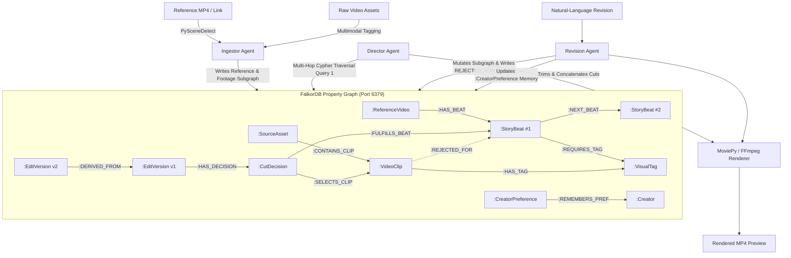

# AI Video Director — Graph-Grounded Agentic Video Editing Studio
**Powered by FalkorDB | Built for Graph Hacks: Context for AI Agents (WeMakeDevs x FalkorDB)**


---

## 🏆 Target Tracks Entered
1. **Track 01 — Agents That Act on Connected Data**  
   *Multi-hop Cypher reasoning that traverses from reference video narrative beats (`:StoryBeat`) through required visual characteristics (`:VisualTag`) and audio mood (`:AudioMood`) to find optimal candidate footage (`:VideoClip`), rejecting clips that violate temporal continuity.*
2. **Track 02 — Agent Memory and Coordination**  
   *Multi-agent coordination (Ingestor Agent ➔ Director Agent ➔ Revision Agent) backed by a persistent Revision Lineage DAG (`(:EditVersion)-[:DERIVED_FROM]->(:EditVersion)`), negative clip memory (`[:REJECTED_FOR]`), and cross-session creator style memory (`(:CreatorPreference)`).*

---

## 🧠 Why FalkorDB is Indispensable (Rule 2 & Rule 3 Compliance)

Rules 2 and 3 of the Graph Hacks Hackathon state that **FalkorDB must be the primary database and that if the product still works once FalkorDB is taken out, the graph is decoration and does not qualify**.

In **AI Video Director**, FalkorDB is the core engine of video synthesis. If FalkorDB is removed, the entire pipeline fails:
- **Zero Flat JSON Prompts:** The Director Agent does not ask an LLM to guess timestamps in a text prompt; it executes multi-hop OpenCypher queries in FalkorDB to traverse `(StoryBeat)-[:REQUIRES_TAG]->(VisualTag)<-[:HAS_TAG]-(VideoClip)`.
- **100% Traceable Cut Decisions:** Every clip on the multitrack timeline is a `:CutDecision` node in FalkorDB linking the exact `:StoryBeat` it fulfills and the `:VideoClip` `[in_sec, out_sec]` it trims, providing complete mathematical traceability and explainability.
- **Stateful Revision Memory & Lineage DAG:** When a user requests a revision in natural language, the Revision Agent mutates only the affected subgraph, records an explicit `[:REJECTED_FOR]` negative memory edge so the old clip is never re-suggested for that beat, and writes durable `(:CreatorPreference)` nodes that persist across projects.

---

## 📐 Multi-Agent Coordination Architecture



---

## 📊 FalkorDB Property Graph Data Model (Rule 10 Mandatory Schema)

### Node Labels & Properties

| Node Label | Key Properties | Purpose in the Graph |
| :--- | :--- | :--- |
| `Creator` | `id`, `name`, `default_aspect_ratio` | Root node for multi-session memory and creator profile. |
| `CreatorPreference` | `id`, `category`, `rule_text`, `weight`, `updated_at` | Persistent procedural/aesthetic memory across sessions (Track 02). |
| `Project` | `id`, `title`, `category`, `target_duration`, `mood`, `aspect_ratio`, `status` | Represents a video production workspace. |
| `ReferenceVideo` | `id`, `source_type`, `url_or_path`, `avg_cut_duration`, `pacing_style`, `total_duration` | Analyzed reference video driving narrative structure and cut rhythm. |
| `StoryBeat` | `id`, `beat_index`, `role`, `target_duration`, `energy_level`, `required_shot_type`, `transition` | Individual structural beat extracted from the reference video. |
| `SourceAsset` | `id`, `filename`, `media_type`, `duration`, `resolution`, `fps` | Raw user-uploaded video asset. |
| `VideoClip` | `id`, `in_sec`, `out_sec`, `duration`, `shot_type`, `energy_level`, `motion_score`, `transcript` | Granular usable sub-clip segmented from a `SourceAsset`. |
| `VisualTag` | `name` (`closeup`, `broll`, `talking_head`, `product_shot`, `screen`, `lifestyle`) | Shared semantic visual node connecting beats and candidate clips. |
| `AudioMood` | `name` (`upbeat`, `calm`, `dramatic`, `conversational`) | Shared audio mood classification connecting beats and clips. |
| `EditVersion` | `id`, `version_num`, `prompt_summary`, `render_status`, `preview_url`, `created_at` | Immutable snapshot of a timeline edit plan in the revision DAG. |
| `CutDecision` | `id`, `timeline_order`, `trim_in_sec`, `trim_out_sec`, `track`, `ai_rationale`, `confidence` | Reified decision node linking an `EditVersion`, a `StoryBeat`, and a `VideoClip` for 100% traceability. |

### Relationship Types (Edges)

| Relationship Type | Start Node | End Node | Edge Properties | Why the Graph Needs This Edge |
| :--- | :--- | :--- | :--- | :--- |
| `[:REMEMBERS_PREF]` | `Creator` | `CreatorPreference` | `confidence`, `session_count` | Persists editing style rules across projects and sessions. |
| `[:OWNS_PROJECT]` | `Creator` | `Project` | `created_at` | Links user workspace to projects. |
| `[:USES_REFERENCE]` | `Project` | `ReferenceVideo` | `imported_at` | Connects project to its structural template. |
| `[:HAS_BEAT]` | `ReferenceVideo` | `StoryBeat` | `beat_index` | Connects reference video to its detected beats. |
| `[:NEXT_BEAT]` | `StoryBeat` | `StoryBeat` | `cut_type` | Ordered temporal chain of the reference narrative structure. |
| `[:REQUIRES_TAG]` | `StoryBeat` | `VisualTag` | `weight` | Defines what visual characteristics a story beat demands. |
| `[:HAS_ASSET]` | `Project` | `SourceAsset` | `uploaded_at` | Connects project to uploaded raw footage. |
| `[:CONTAINS_CLIP]` | `SourceAsset` | `VideoClip` | `clip_index` | Links raw file to segmented sub-clips. |
| `[:NEXT_CLIP_IN_SOURCE]` | `VideoClip` | `VideoClip` | `gap_sec` | Preserves chronological order in raw footage for continuity checks. |
| `[:HAS_TAG]` | `VideoClip` | `VisualTag` | `confidence` | Connects segmented footage to shared visual tags for graph traversal. |
| `[:HAS_MOOD]` | `VideoClip` | `AudioMood` | `confidence` | Connects footage to mood nodes. |
| `[:HAS_VERSION]` | `Project` | `EditVersion` | `is_active` | Tracks all timeline versions for a project. |
| `[:DERIVED_FROM]` | `EditVersion` | `EditVersion` | `revision_prompt`, `changed_beat_index` | Forms the revision history DAG for version comparison and undo. |
| `[:HAS_DECISION]` | `EditVersion` | `CutDecision` | `timeline_order` | Links a version to its ordered timeline cuts. |
| `[:FULFILLS_BEAT]` | `CutDecision` | `StoryBeat` | `pacing_fit_score` | Traces which reference beat a timeline cut satisfies. |
| `[:SELECTS_CLIP]` | `CutDecision` | `VideoClip` | `trim_in`, `trim_out` | Traces the exact raw source clip and timestamps used in the cut. |
| `[:REJECTED_FOR]` | `VideoClip` | `StoryBeat` | `reason`, `rejected_in_version` | Negative memory edge preventing the agent from re-picking rejected clips. |

---

## ⚡ Core Cypher Queries (Rule 10 Mandatory Section)

### Query 1: Multi-Hop Beat-to-Clip Candidate Matching (Director Agent)
```cypher
MATCH (p:Project {id: $project_id})-[:USES_REFERENCE]->(r:ReferenceVideo)-[:HAS_BEAT]->(b:StoryBeat)
MATCH (b)-[:REQUIRES_TAG]->(t:VisualTag)<-[ht:HAS_TAG]-(c:VideoClip)<-[:CONTAINS_CLIP]-(sa:SourceAsset)<-[:HAS_ASSET]-(p)
WHERE c.duration >= b.target_duration
  AND NOT (c)-[:REJECTED_FOR]->(b)
OPTIONAL MATCH (c)-[:HAS_MOOD]->(m:AudioMood {name: p.mood})
WITH b, c, sa,
     collect(t.name) AS matched_tags,
     sum(ht.confidence) AS tag_score,
     abs(c.energy_level - b.energy_level) AS energy_diff,
     CASE WHEN m IS NOT NULL THEN 1.5 ELSE 0.0 END AS mood_bonus
WITH b, c, sa, matched_tags,
     (tag_score * 2.0 + mood_bonus - (energy_diff * 0.5)) AS total_match_score
ORDER BY b.beat_index ASC, total_match_score DESC
RETURN b.id AS beat_id,
       b.beat_index AS beat_index,
       b.role AS beat_role,
       b.target_duration AS target_duration,
       c.id AS clip_id,
       sa.filename AS source_file,
       c.in_sec AS clip_in_sec,
       c.out_sec AS clip_out_sec,
       matched_tags,
       total_match_score
```

### Query 2: Building a Revision Version in the Lineage DAG (Revision Agent)
```cypher
MATCH (p:Project {id: $project_id})-[:HAS_VERSION]->(prev:EditVersion {id: $prev_version_id})
MATCH (prev)-[:HAS_DECISION]->(old_dec:CutDecision {timeline_order: $target_order})-[:FULFILLS_BEAT]->(b:StoryBeat)
MATCH (old_dec)-[:SELECTS_CLIP]->(old_clip:VideoClip)
MERGE (old_clip)-[:REJECTED_FOR {reason: $user_prompt, rejected_in_version: prev.version_num}]->(b)
CREATE (next_v:EditVersion {
  id: $new_version_id,
  version_num: prev.version_num + 1,
  prompt_summary: $user_prompt,
  render_status: 'queued',
  preview_url: '',
  created_at: $timestamp
})
CREATE (p)-[:HAS_VERSION {is_active: true}]->(next_v)
CREATE (next_v)-[:DERIVED_FROM {revision_prompt: $user_prompt, changed_beat_index: $target_order}]->(prev)
RETURN next_v.id AS new_version_id, b.id AS target_beat_id
```

### Query 3: Full Edit Traceability & Explainability Query (Powers Studio Inspector)
```cypher
MATCH (v:EditVersion {id: $version_id})-[:HAS_DECISION]->(d:CutDecision)
MATCH (d)-[:FULFILLS_BEAT]->(b:StoryBeat)<-[:HAS_BEAT]-(r:ReferenceVideo)
MATCH (d)-[:SELECTS_CLIP]->(c:VideoClip)<-[:CONTAINS_CLIP]-(sa:SourceAsset)
OPTIONAL MATCH (b)-[:NEXT_BEAT]->(next_b:StoryBeat)
RETURN d.id AS decision_id,
       d.timeline_order AS order,
       d.track AS track,
       b.id AS beat_id,
       b.role AS narrative_beat,
       b.target_duration AS beat_target_sec,
       sa.id AS source_asset_id,
       sa.filename AS source_asset,
       c.id AS clip_id,
       d.trim_in_sec AS source_in_sec,
       d.trim_out_sec AS source_out_sec,
       d.ai_rationale AS explanation,
       d.confidence AS match_confidence,
       c.shot_type AS shot_type,
       c.energy_level AS energy_level
ORDER BY d.timeline_order ASC
```

### Query 4: Version-to-Version Graph Diff Query (Revision History & Comparison)
```cypher
MATCH (v1:EditVersion {id: $version_a_id})-[:HAS_DECISION]->(d1:CutDecision)-[:FULFILLS_BEAT]->(b:StoryBeat)
MATCH (d1)-[:SELECTS_CLIP]->(c1:VideoClip)<-[:CONTAINS_CLIP]-(sa1:SourceAsset)
MATCH (v2:EditVersion {id: $version_b_id})-[:HAS_DECISION]->(d2:CutDecision)-[:FULFILLS_BEAT]->(b)
MATCH (d2)-[:SELECTS_CLIP]->(c2:VideoClip)<-[:CONTAINS_CLIP]-(sa2:SourceAsset)
RETURN b.beat_index AS beat_index,
       b.role AS beat_role,
       sa1.filename AS v1_source,
       c1.id AS v1_clip_id,
       d1.trim_in_sec AS v1_in,
       d1.trim_out_sec AS v1_out,
       sa2.filename AS v2_source,
       c2.id AS v2_clip_id,
       d2.trim_in_sec AS v2_in,
       d2.trim_out_sec AS v2_out,
       CASE WHEN c1.id <> c2.id OR d1.trim_in_sec <> d2.trim_in_sec OR d1.trim_out_sec <> d2.trim_out_sec
            THEN 'MODIFIED' ELSE 'UNCHANGED' END AS diff_status,
       d2.ai_rationale AS v2_reason
ORDER BY b.beat_index ASC
```

### Query 5: Cross-Session Creator Preference Retrieval (Track 02 Agent Memory)
```cypher
MATCH (u:Creator {id: $creator_id})-[r:REMEMBERS_PREF]->(pref:CreatorPreference)
RETURN pref.id AS id,
       pref.category AS category,
       pref.rule_text AS rule_text,
       pref.weight AS weight,
       r.session_count AS reinforced_sessions,
       pref.updated_at AS updated_at
ORDER BY pref.weight DESC
```

---

## 🖥️ 10 Complete Screens Built

Accessible effortlessly via the left Studio Navigation Rail:
1. **Landing Page & Onboarding:** High-impact hero, interactive 3-step architecture walkthrough, and "1-Click Demo Seed" button.
2. **Home Dashboard & Projects:** Real-time FalkorDB project library with category badges, aspect ratio tags, and version counters.
3. **New Project Wizard:** 3-step setup modal configuring aspect ratio (16:9, 9:16, 1:1), duration, mood, and creator style rules.
4. **Reference Video Import & Analysis:** PySceneDetect decomposition into `:StoryBeat` chains with visual energy and cut rhythm.
5. **Footage Upload & Media Library:** Segmented `:VideoClip` cards with auto-detected `:VisualTag` pills, duration, and energy metrics.
6. **AI Editing Studio (Centerpiece):** Real HTML5 video player, Multitrack Timeline (V1 Primary, V2 B-Roll, A1 Audio), Live FalkorDB Traceability Inspector, and Conversational Revision Chat.
7. **Revision History & Version Comparison:** Visual EditVersion lineage DAG, side-by-side synchronized video players, and Cypher Query 4 diff matrix.
8. **Master Render Export:** 1080p/4K resolution selection, real playable MP4 download, and cut-list JSON/EDL export.
9. **Social Accounts & Publishing Gate:** Multi-channel status (YouTube, Vimeo, LinkedIn, Instagram) with explicit "Require Human Approval Before Publishing" toggle ON by default.
10. **User Settings & Persistent Memory:** Creator profile and live FalkorDB `:CreatorPreference` memory manager (Track 02).

---

## 🚀 Quick Start (Local Setup)

### Option 1: Docker (Recommended)
```bash
# 1. Start FalkorDB (Port 6379 & Browser on Port 3000)
docker run -p 6379:6379 -p 3000:3000 --name falkordb-director -d falkordb/falkordb:latest

# 2. Start Backend
cd backend
python3 -m venv venv && source venv/bin/activate
pip install -r requirements.txt
uvicorn backend.main:app --host 0.0.0.0 --port 8000

# 3. Start Frontend (in a new terminal)
cd frontend
npm install
npm run dev -- -p 3001
```

### Option 2: 1-Command Docker Compose
```bash
docker compose up --build
```

Open:
- **Studio UI:** `http://localhost:3001`
- **FastAPI API & Docs:** `http://localhost:8000/docs`
- **FalkorDB Visual Browser:** `http://localhost:3000`

👉 **Click "1-Click Demo Seed" in the Studio UI or run `curl -X POST http://localhost:8000/api/seed-demo` to seed sample reference beats, source clips, and synthesize EditVersion v1 immediately!**

---

## 🤖 AI Coding Assistant Disclosure (Rule 11 Compliance)

This project was developed during the Graph Hacks hackathon window using **Antigravity IDE** as an AI coding assistant for boilerplate scaffolding and UI styling. All graph modeling, Cypher query design, multi-agent coordination architecture, and video rendering pipelines were designed, verified, and tested by the team.
